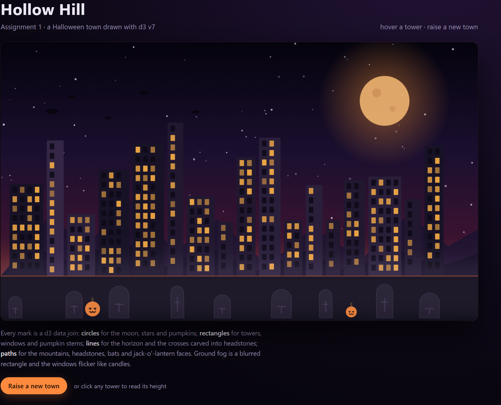

# Hollow Hill — A1: Hello World, GitHub and d3

**Live site:** https://YOURUSERNAME.github.io/a1-ghd3/

<!-- TODO before submitting: open the page in Chrome, take a screenshot (Win+Shift+S),
     save it as screenshots/skyline.png, then uncomment the image line below. -->
<!--  -->

A single-file d3 scene of a Halloween town at night. A hazy harvest moon hangs over a
ridge of dark hills, five bats cross the sky, and the town below is a row of near-black
towers whose warm windows flicker like candles. The foreground is a foggy graveyard:
nine headstones with carved crosses and two jack-o'-lanterns. Hovering a tower shows its
height; the button raises a new town from a different seed.

## How it is built

Everything is one `index.html`. d3 v7 is loaded from jsDelivr, and every mark is created
through a data join rather than hand-placed in the markup.

| Primitive | Where it appears | Colour |
| --- | --- | --- |
| Circles | moon disc + halo + two craters, 90 stars, two pumpkin bodies | `#ffbf74`, `#efe4ff`, `#e8792b` |
| Rectangles | tower bodies, window grid, pumpkin stems, sky and ground panels | `#181226`–`#342645`, lit windows `#ffb347` |
| Lines | horizon, the crosses engraved on headstones | `#c9552a`, `#332942` |
| Paths | two hills, nine headstones, five bats, pumpkin faces | `#1c1330`, `#140e24`, `#171221`, `#08050f` |

Geometry lives in a fixed `960 × 560` viewBox, so the drawing scales with the window
without recomputing anything.

## Technical achievements

1. **Keyed data joins for four datasets.** Towers, windows, headstones, and bats are
   arrays driven through `.data().join()`. Windows are derived from each tower's width
   and height, so they re-flow when a tower changes size.
2. **A joined update, not a redraw.** "Raise a new town" joins a new dataset to the
   existing elements: survivors transition to new heights, positions, and colours, new
   towers rise from the ground, and retired towers collapse and are removed.
3. **Seeded generation.** `d3.randomLcg(seed)` makes the opening composition reproducible
   and makes each reroll a single number rather than hidden global state.
4. **Fog with an SVG filter.** The ground haze is a plain rectangle pushed through
   `feGaussianBlur` (`stdDeviation` 22), so the blur is resolution-independent and costs
   one filter instead of a stack of translucent shapes.
5. **CSS-keyframe animation.** Lit windows flicker with a `candle` keyframe at three
   staggered delays, and the moon breathes on a slow `haze` cycle. Both stop under
   `prefers-reduced-motion: reduce`.
6. **Responsive SVG.** One viewBox plus `preserveAspectRatio` and `width: 100%` in CSS
   keeps the composition intact from phone to desktop without JavaScript resize handlers.
7. **Interaction and accessibility.** A pointer tooltip reads the hovered tower's height,
   the reroll control is a real focusable `<button>`, and the SVG carries `role="img"`
   with `<title>` and `<desc>` describing the scene.

## Design achievements

1. **Silhouette-first palette.** The town is four near-black purples so it reads as a
   silhouette, with one warm accent (`#ffb347`) reserved for lit windows and pumpkins.
   The only saturated colour is the ember horizon, which makes the dark shapes legible.
2. **Depth through layering, not outlines.** Sky, stars, moon, far hills, near hills,
   towers, cemetery, fog. Each layer is darker and flatter as it recedes; nothing uses a
   stroke to separate itself from the layer behind it.
3. **A foreground that tells the story.** The bottom band is no longer water but a
   cemetery: rounded headstones of varied widths and small tilts, crosses etched in a
   lighter grey, pumpkins at two scales. Fog sits over the bases so the graves and the
   town share one atmosphere instead of looking pasted together.
4. **Composition.** Horizon at about five-sixths height, the moon high on the right, bats
   climbing from the left, and tower widths varying in a loose rhythm so the skyline never
   reads as a bar chart. The pumpkin at the left balances the moon's weight on the right.
5. **Motion with a purpose.** Towers and windows enter in a short left-to-right stagger,
   the 650 ms height transition keeps the eye on what changed, and the slow window flicker
   gives the town a pulse without pulling attention from the shapes.

## Sources and tools

- Starter files: fork of the course repository `a1-ghd3` (instructor-provided HTML shell).
- d3 v7 via jsDelivr, https://cdn.jsdelivr.net/npm/d3@7.
- No other libraries, images, or copied examples. The composition, data, and styling are
  my own.
- AI assistance: [describe what you used it for and how you changed the result, per the
  course syllabus policy — or delete this line if it does not apply].

## Run it locally

```bash
python -m http.server 8000
```

Then open <http://localhost:8000> in Chrome. (Opening `index.html` directly also works
because d3 is loaded from a CDN.)
